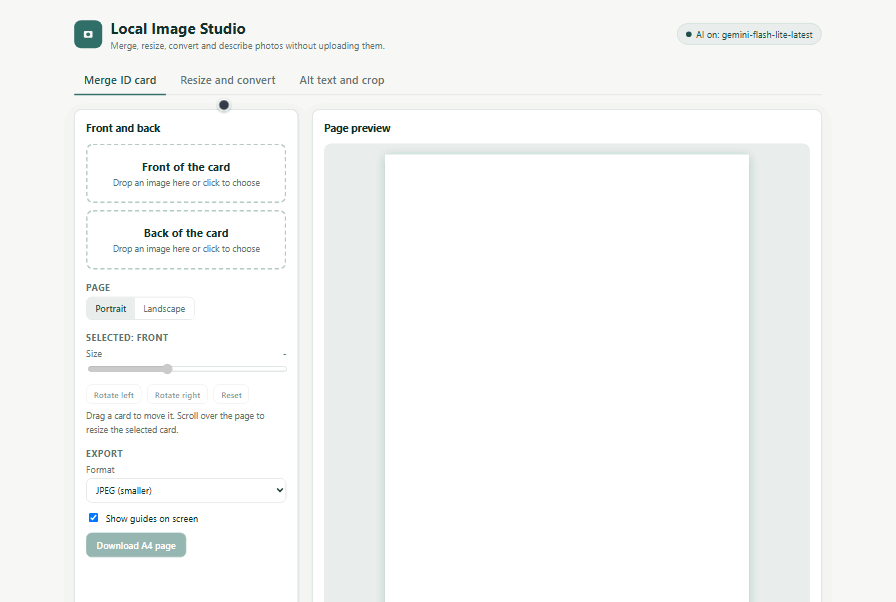
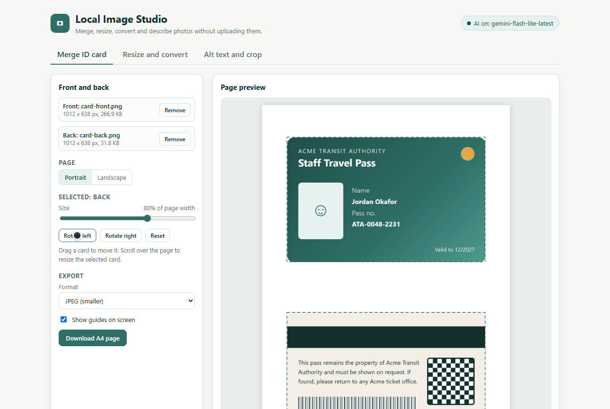
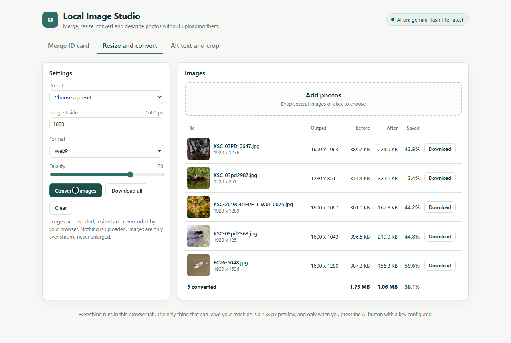
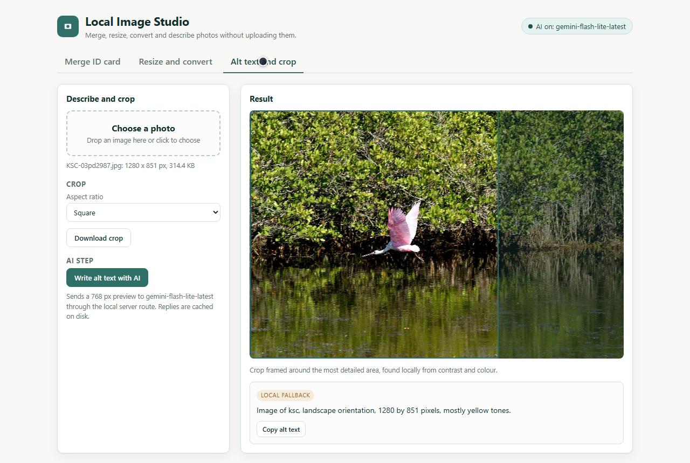
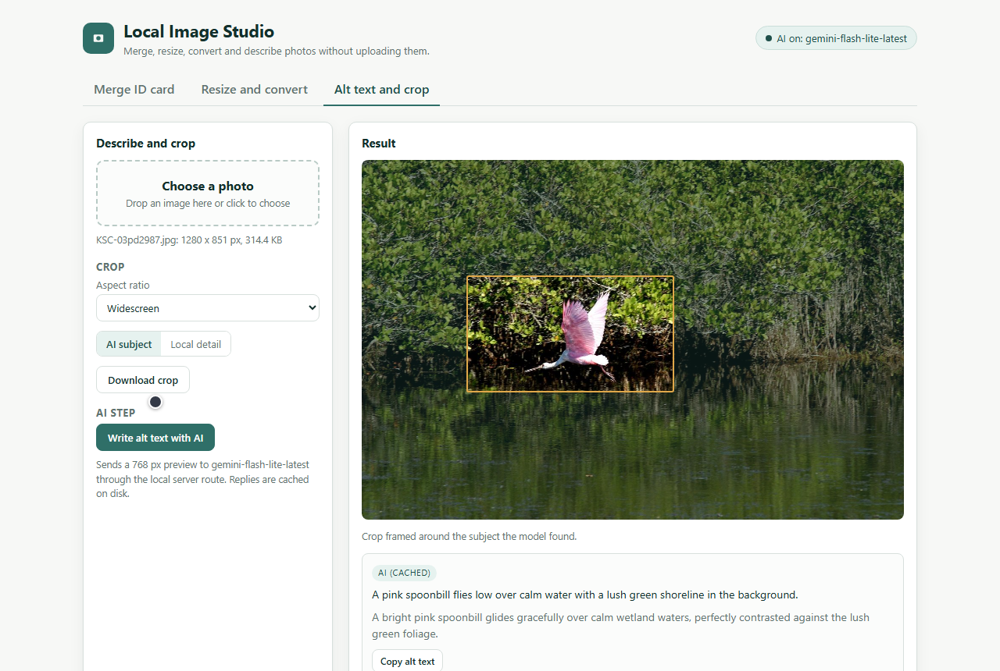
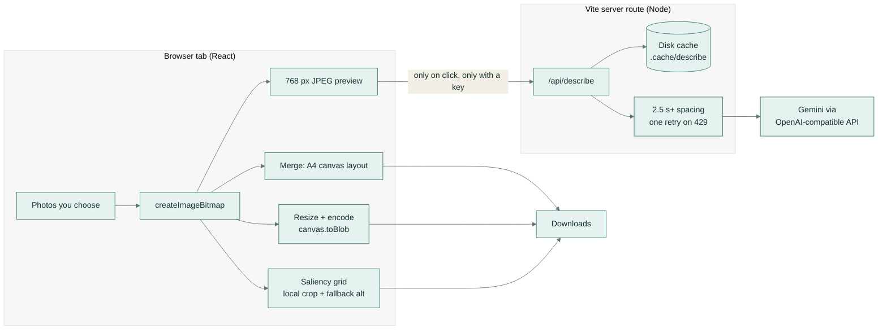
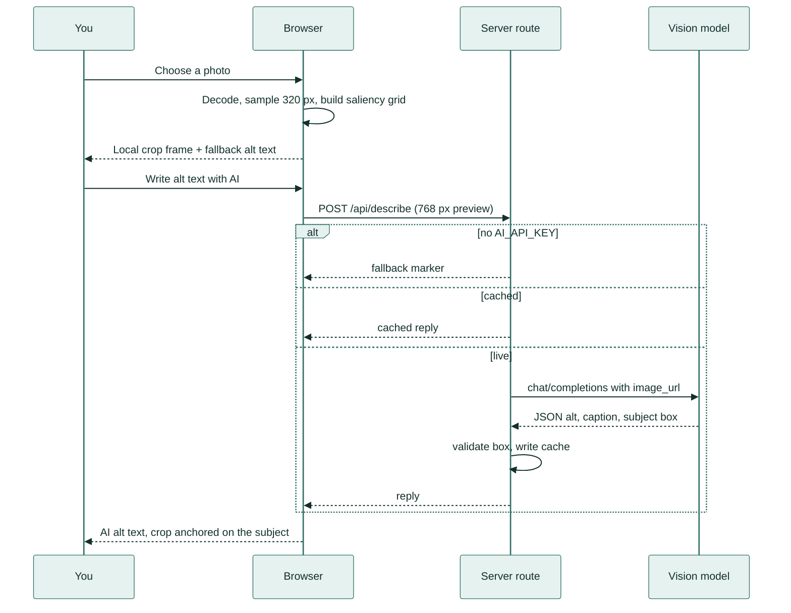
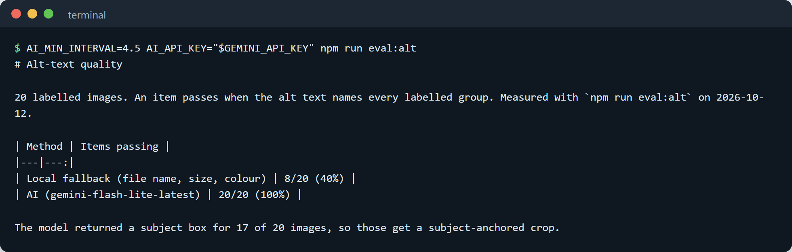
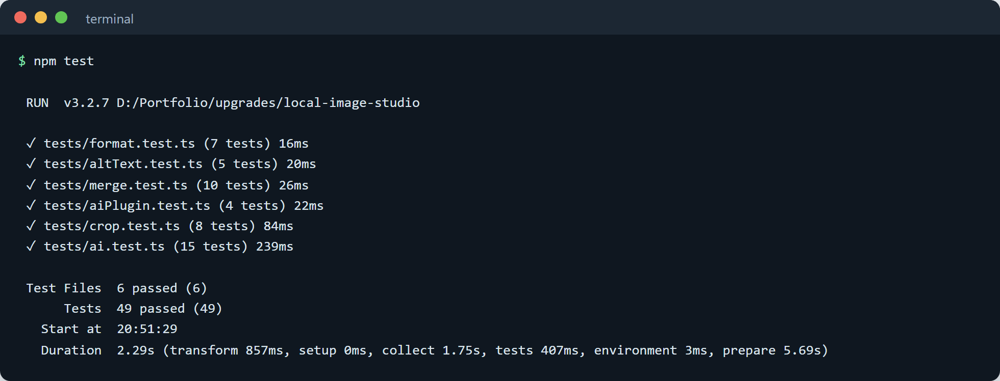

# Local Image Studio



*The whole app in one take. Two sides of a staff pass become one printable page, five photos are resized for the web, and a bird photo gets a crop and a one-line description.*

## What it does

Local Image Studio is a photo toolkit that runs in your web browser. It puts the front and back of an ID card onto one printable page, shrinks and converts batches of photos for the web or email, and suggests a crop and a short written description of each picture. Your photos never leave your computer. The only exception is the optional description step, which sends a small preview only when you press the button.

## A real-life example

**Priya runs the front office at Acme Lettings, a small rental agency.**

- **Before:** every new tenant emails phone photos of their ID card, front and back, often 4 MB each. Priya opens a desktop editor, pastes both sides onto a page and exports a PDF for the file. Then she resizes the flat photos for the listings site, which rejects anything over 2 MB. Finally she types a description for each photo, because the site asks for one for screen-reader users. A new listing with 12 photos takes her about 45 minutes. She also feels uneasy pasting tenants' ID cards into free websites that upload them to who-knows-where.
- **With Local Image Studio:** she drops both card photos onto the merge tab and downloads one A4 page. She drops all 12 listing photos onto the convert tab, picks "Web", and downloads them resized for the web, a fraction of the 4 MB originals. On the third tab she gets a suggested crop and a ready-to-paste description for each photo.
- **After:** a listing takes about 10 minutes instead of 45. That saves roughly 6 hours a month at 10 listings. ID cards stay on her own computer the whole time.

## How you would use it

1. Open the app in your browser. A developer runs one command to start it (see [Setup](#setup)).
2. **To merge an ID card:** on **Merge ID card**, click the first box and choose the front photo, then the second box for the back. Drag either side to move it, use **Rotate** if it is sideways, and click **Download A4 page**.
3. **To shrink photos:** on **Resize and convert**, drop in as many photos as you like and pick a preset such as "Web (1600 px, WebP)". Click **Convert**, then **Download all**. The table shows how much space each photo saved.
4. **To get a crop and a description:** on **Alt text and crop**, choose a photo and pick a shape (Square, Widescreen, Story and so on). A frame shows the suggested crop. Click **Download crop** to save it, and **Write alt text with AI** to get a one-sentence description, then **Copy alt text** to paste it wherever you need it.

| | |
|---|---|
|  |  |
| *Merge tab: both sides of a fictional "Acme" pass placed on one A4 page, with dashed guides that do not print.* | *Convert tab: five photos resized to 1600 px WebP, with the space saved per photo and in total (1.75 MB down to 1.06 MB; the one photo that was already smaller than the target grew 2.4% and is marked in amber).* |
|  |  |
| *Without AI: a square crop placed over the most detailed part of the photo, and a basic description from size and colour.* | *With AI: a widescreen crop and the sentence "A pink spoonbill flies low over calm water with a lush green shoreline in the background." The orange frame is the crop anchored on the bird the model found.* |

---

## Key features

- **ID card merge.** Front and back on an A4 page in portrait (stacked) or landscape (side by side). You can drag, scroll to resize, rotate in 90° steps and reset. It exports a 300 dpi JPEG or PNG.
- **Batch resize and convert.** WebP, JPEG or PNG output, a longest-side limit (images are only ever shrunk), a quality slider and presets. It shows before and after sizes for each file and in total.
- **Smart crop with no model.** A saliency grid (a map of which parts of the photo have the most contrast and colour) picks the crop window for any aspect ratio.
- **AI alt text and subject crop.** An optional call to a vision model returns alt text (the short description screen readers read aloud), a caption and the main subject's bounding box. The crop can then be anchored on that subject.
- **Private by default.** Decoding, resizing and encoding happen in the browser's canvas. The AI step sends only a 768 px JPEG preview, through a small server route, and only on a click.
- **Works without a key.** With no `AI_API_KEY` the app still runs fully. Descriptions fall back to a local sentence built from the file name, shape, size and main colour.

## How it works



The main flow for one photo on the **Alt text and crop** tab:



Step by step:

1. **Load.** Each file is decoded with `createImageBitmap`. Nothing is sent anywhere.
2. **Merge.** Card positions are stored as fractions of the page, so the same layout draws on the 520 px preview and on the 2480 × 3508 px (A4, 300 dpi) export. Hit-testing works on the rotated rectangle, so you can grab a card even after turning it.
3. **Convert.** The image is drawn onto a canvas at the target size with high-quality smoothing, then encoded with `canvas.toBlob` in the chosen format and quality. JPEG gets a white background so transparent PNGs do not turn black.
4. **Local crop.** A 320 px copy is split into a 24 × 24 grid. Each cell is scored by brightness spread (contrast) and colourfulness. Every window of the chosen aspect ratio at five sizes is scored by mean interest, weighted towards larger windows, and the best one wins.
5. **AI step.** The server route checks the disk cache (keyed by a SHA-256 of model and preview). If there is no cached reply, it waits until at least 2.5 s (or `AI_MIN_INTERVAL`) have passed since the last call and sends one OpenAI-style chat completion. A 429 (rate limit) gets one retry after 8 s. The reply's JSON is parsed even inside code fences. Subject boxes are accepted on a 0–1 or 0–1000 scale, and boxes too small to crop around are dropped.
6. **Fallback.** With no key, a failed call or an unreadable reply, the UI keeps the local crop and the local sentence and shows why.

## Evaluation

Two measurements, both run through the app's own browser code in headless Chromium (`src/evalHarness.ts`), so the numbers match what the UI does.

Both use the twelve public-domain NASA photos committed in [`eval/photos/`](eval/photos) (wildlife, landscapes, an aircraft, Earth from orbit; see [`CREDITS.md`](eval/photos/CREDITS.md)), so anyone can rerun them.

**Output size reduction:** `npm run eval:size` (or `npm run eval:size -- <your folder>`). The photos are already web-compressed downloads, 57 KB to 396 KB and 1280 to 1920 px wide, 2.9 MB in total.

| Preset | Total after | Total saved | Median saved per image | Smallest saving |
|---|---:|---:|---:|---:|
| Web: 1600 px, WebP, quality 80 | 1.76 MB | **39.3%** | 51.5% | -7.6% |
| Email: 1200 px, JPEG, quality 80 | 1.60 MB | **44.8%** | 50.3% | 10.5% |
| Same size, WebP, quality 85 | 2.79 MB | **3.8%** | 13.7% | -25.1% |

Resizing does most of the work. Re-encoding a photo that is already small and heavily compressed can make it slightly bigger: here, two 1280 px photos grew under the Web preset. The convert table marks any file that grew in amber so you can keep the original instead. Camera originals, which are usually several megabytes, shrink far more than these.

**Alt-text quality:** `AI_API_KEY="$GEMINI_API_KEY" npm run eval:alt`, on 20 labelled images. Eight are generated shapes with known content (`npm run eval:samples`) and twelve are the NASA photos, named by their image ID as a camera would name them. Each label is a set of word groups, for example `[spoonbill|bird|heron…] + [pink] + [water|marsh|flying…]`. An item passes only when the alt text contains a word from every group. Labels are in [`eval/labels.json`](eval/labels.json).

| Method | Items passing |
|---|---:|
| Local fallback (file name, shape, size, main colour) | 8 / 20 (40%) |
| AI: `gemini-flash-lite-latest` | **20 / 20 (100%)** |

The local fallback passes all eight generated shapes, whose file names describe them, and none of the twelve photos, whose names are just image IDs. That gap is what the AI step is for. The model also returned a usable subject box for 17 of the 20 images, and those get a crop anchored on the subject; the rest use the local saliency crop.

Full per-image tables are in [`eval/results/`](eval/results).



*The alt-text evaluation in a terminal: the local fallback passes 8 of 20 images and the AI step passes all 20.*

## Tech stack

- **Frontend:** React 19 and TypeScript (strict) built with Vite 6, using the Canvas 2D API, `createImageBitmap` and `canvas.toBlob`. There is no image library.
- **Server route:** a Vite plugin middleware on Node 22 (`server/aiPlugin.ts`) serving `/api/status` and `/api/describe` from the same process as the app.
- **AI:** any OpenAI-compatible chat completions endpoint. The default is Gemini (`https://generativelanguage.googleapis.com/v1beta/openai`, model `gemini-flash-lite-latest`) called with plain `fetch`, plus a disk cache, call spacing and one retry.
- **Quality:** Vitest, ESLint 9 with typescript-eslint and react-hooks, `tsc --noEmit` for both browser and Node code, and GitHub Actions CI.
- **Evaluation:** playwright-core driving a headless Chromium against the dev server, and a dependency-free PNG writer for the labelled samples.

## Setup

You need Node 22.6 or newer. The eval scripts also drive a headless browser: set `CHROME_PATH` to any Chrome or Chromium executable, or run `npx playwright-core install chromium-headless-shell` once to use Playwright's own.

```bash
npm run setup     # npm install + generate the labelled sample images
npm run demo      # start the app and open http://localhost:5173
```

The app works fully without a key. To turn on the AI step, pass the key at runtime only:

```bash
AI_API_KEY="$GEMINI_API_KEY" npm run demo
```

### Configuration

| Variable | Purpose | Default |
|---|---|---|
| `AI_API_KEY` | Key for the OpenAI-compatible endpoint. Unset means AI off. | unset |
| `AI_BASE_URL` | Endpoint base URL | Gemini OpenAI-compatible URL |
| `AI_MODEL` | Model name | `gemini-flash-lite-latest` |
| `AI_MIN_INTERVAL` | Minimum seconds between live model calls (never below 2.5) | `2.5` |
| `AI_CACHE_DIR` | Where replies are cached | `.cache/describe` |
| `CHROME_PATH` | Browser used by the eval scripts | Playwright's installed Chromium |

### Commands

| Command | What it does |
|---|---|
| `npm run demo` / `npm run dev` | Start the app with the API route |
| `npm run build` then `npm run preview` | Production build, served with the same API route |
| `npm test` | Unit tests |
| `npm run lint` / `npm run typecheck` | ESLint and TypeScript checks |
| `npm run check` | Lint, typecheck, test and build, the same as CI |
| `npm run eval:samples` | Regenerate `eval/labelled/*.png` |
| `npm run eval:size [-- <folder>]` | Size reduction (default: `eval/photos`) |
| `npm run eval:alt` | Alt-text scoring (add `AI_API_KEY` to include the model) |

## Project structure

```text
local-image-studio/
├── index.html
├── src/
│   ├── App.tsx                # tabs and AI status pill
│   ├── components/
│   │   ├── MergeTool.tsx      # ID card front/back on an A4 canvas
│   │   ├── ConvertTool.tsx    # batch resize, convert, size table
│   │   ├── DescribeTool.tsx   # crop suggestion and alt text
│   │   └── Dropzone.tsx
│   ├── lib/
│   │   ├── merge.ts           # page layout, fit, hit test, move, rotate
│   │   ├── crop.ts            # saliency grid, crop search, subject crop
│   │   ├── altText.ts         # colour naming and local fallback sentence
│   │   ├── imageOps.ts        # canvas decode, resize, encode, export
│   │   ├── format.ts          # sizes, percentages, file names
│   │   └── aiClient.ts        # calls to the server route
│   ├── evalHarness.ts         # dev-only bridge used by eval scripts
│   └── styles.css
├── server/
│   ├── ai.ts                  # Describer: cache, spacing, retry, parsing
│   └── aiPlugin.ts            # /api/status and /api/describe middleware
├── eval/
│   ├── make-samples.ts        # labelled synthetic images
│   ├── size-reduction.ts
│   ├── alt-text.ts
│   ├── labels.json
│   ├── labelled/              # generated sample PNGs
│   ├── photos/                # 12 public-domain NASA photos + CREDITS.md
│   └── results/               # latest eval tables (md + json)
├── tests/                     # Vitest unit tests
├── docs/                      # demo GIF, screenshots, fictional card samples
└── .github/workflows/ci.yml
```

## Tests

49 unit tests in 6 files cover page layout and rotation-aware fitting, hit-testing, the saliency crop and subject crop, colour naming and fallback alt text, and file-name handling. They also cover the AI route: no network call without a key, the request shape, the disk cache across instances, 2.5 s spacing (including concurrent requests), the 429 retry, error fallbacks that never echo the key, reply and box parsing, and the HTTP handler. Tests use a fake `fetch` and a fake clock, so CI never calls a model.

```bash
npm run check
```



*All 49 unit tests passing locally with the same command CI runs.*

## Licence

[MIT](LICENSE), © 2026 Samiul Huda.
